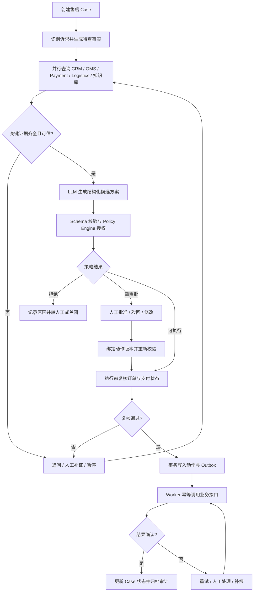

# ResolveFlow 企业售后与订单异常闭环 Agent 平台 PRD

> 版本：v1.0
> 项目性质：个人开源项目
> 项目时间：2026.03—2026.06
> 目标读者：产品、后端、AI 应用开发、测试与项目评审人员

## 1. 产品概述

ResolveFlow 面向多问题售后 Case，提供诉求拆解、证据调查、候选方案、策略校验、人工审批、可靠执行和结案核对。本文描述产品目标、已实现功能及后续迭代需求；接口和运行方式见 `README.md`。

本 PRD 覆盖售后异常 Case 的受理、证据聚合、方案生成、策略校验、人工审批、可靠执行、审计与恢复。业务动作以退款、补发为代表，具体金额、时效和审批阈值由企业策略配置决定。

## 2. 背景与目标

电商及企业售后异常通常涉及 CRM、订单管理系统（OMS）、支付、物流和知识库。客服需要在分散系统中核对诉求与事实，再决定退款、补发或转人工。信息缺失、模型误判、重复操作和执行中断都会增加业务风险。

ResolveFlow 的目标是把一条售后异常处理成**可追踪的闭环**：识别用户诉求 → 汇集带来源的事实 → 生成候选方案 → 用确定性规则授权 → 必要时人工审批 → 幂等执行 → 核对结果并留下审计记录。大模型参与理解和方案生成，但业务授权与实际执行由可校验的程序控制。

### 2.1 目标用户

| 角色 | 主要诉求 |
| --- | --- |
| 客服/售后专员 | 快速看到用户诉求、订单事实、候选方案与依据；必要时介入审批 |
| 业务主管/风控人员 | 配置并执行退款、补发等动作的准入规则，审查高风险操作 |
| 系统运维/开发人员 | 排查跨系统调用失败、任务重试和链路异常，回放 Case |

## 3. 产品范围

### 3.1 已实现内容

1. **四角色分析流程**：Case Coordinator 派发履约和资金调查任务；两个调查角色并行检查有权限读取的证据；Resolution Planner 生成候选动作。LangGraph 负责单次分析编排，Case、证据、方案和执行状态保存在业务数据库。
2. **证据聚合**：通过可配置的 CRM、OMS、Payment、Logistics 和知识库只读 HTTP 接口并发查询，统一记录事实、来源、查询时间与版本；冲突或关键字段缺失时阻止相关动作自动执行。
3. **规则决策与审批**：模型接口可用于拆案、调查字段选择和候选方案；未配置模型时使用确定性逻辑。类型化 Schema 和 Policy Engine 校验业务条件，审批支持批准、驳回及修改方案，修改后重新校验。
4. **整案约束与可靠执行**：执行前检查 Subcase 依赖、累计退款额与同 SKU 动作冲突；事务内写入 Outbox，独立 Worker 通过稳定幂等键执行模拟退款或补发；Case 时间线及结案证明提供逐问题核对。

### 3.2 为完整产品建议补齐的范围

下一阶段建设操作台、策略配置界面、人工审批队列、报表、管理员权限、真实外部系统适配、消息通知、灰度发布和正式 SLA。交付顺序见第 10 节。

### 3.3 暂不纳入首期

不自动处理无法核实订单归属或缺少关键证据的 Case；不允许 LLM 绕过策略直接调用退款/补发接口；不承诺所有外部系统具备原子跨系统事务。跨系统结果以状态记录、重试和补偿流程收敛。

### 3.4 差异化定位：从单条工单流程到可验证的 CaseGraph

**定位主张**：ResolveFlow 面向“一条诉求包含多个业务问题、多个系统事实和多个高风险动作”的售后异常。主 Case 负责整体目标、共享证据和最终结案；Subcase 代表一个可独立判定与验收的业务问题，例如“查明重复扣款”“处理缺件”“确认物流延误”。多个 Subcase 形成带依赖与冲突关系的 CaseGraph，系统在执行前统一校验整案约束，在执行后按每个问题的实际结果结案。

这与仅按“查询订单 Agent / 退款 Agent / 物流 Agent”分配技能不同：**Subcase 是业务责任和结果单元**，可以调用多个工具或 Agent；同一个工具也可服务多个 Subcase。拆解本身只是手段，真正有价值的是以下闭环机制：

1. **问题级责任**：每个 Subcase 有目标、所需证据、负责人、动作候选、状态和完成条件，避免主 Case 被单一“已回复/已退款”状态提前关闭。
2. **证据复用与失效传播**：订单、支付、物流等事实被多个 Subcase 引用；源数据变化时，依赖它的方案和审批自动标记为待复核。
3. **跨问题约束**：主 Case 维护退款总额、补发次数、互斥动作、同一订单的重复赔付等全局约束，防止每个 Subcase 局部正确但整体超额或重复处理。
4. **整体方案提交**：先形成包含多个动作的解决计划，校验依赖顺序、冲突和审批，再逐项可靠执行；外部动作部分成功时保留各 Subcase 的真实状态并触发补偿或人工接管。
5. **结案证明**：只有所有必需 Subcase 达成完成条件、外部动作结果核实且无未决风险时，主 Case 才能结案，并给出可追溯的证据与执行记录。

**示例**：用户称“订单少一件商品、送达超时，还被重复扣款”。系统拆出缺件、物流延误、重复支付三个 Subcase。它们共享订单和支付证据；重复支付需要先查清资金流水，缺件可能触发补发或部分退款，延误可能触发补偿。整案规则检查补偿总额与互斥关系，避免三个子问题分别批准退款后超出订单实付。若补发成功而退款接口超时，主 Case 保持部分完成，并继续核查退款结果，不提前标记为已解决。

**功能进展**：主 Case/Subcase、依赖关系、Case 级证据版本失效、累计退款上限、同 SKU 动作冲突检查、自然语言拆案草稿、整案计划预览和结案证明查询均已实现。字段级历史证据快照、显式冲突边、真实外部系统回执核对与补偿列入后续迭代。

**差异化验证指标（规划）**：复杂 Case 的正确拆解率、跨 Subcase 冲突发现率、证据变更后的失效拦截率、整案误结案率、超额/重复赔付率，以及部分失败后的恢复成功率。评测集应包含多诉求、证据冲突、并发审批、外部接口超时和部分执行成功等场景，并与“不拆 Subcase 的单流程基线”比较。

**市场定位**：ResolveFlow 聚焦复杂售后的整案一致性与逐问题结案核对。相较于通用的工单自动化能力，产品重点是让多个 Subcase 共享证据、统一检查赔付约束，并保留各问题和外部动作的实际结果。相关产品与框架能力参考：[Salesforce Agentforce 开发教程](https://developer.salesforce.com/workshops/agentforce-new-workshop/builder/1-get-started)、[Microsoft Case Management Agent 文档](https://learn.microsoft.com/en-us/dynamics365/customer-service/administer/set-up-case-resolution-agent)、[LangGraph 官方文档](https://docs.langchain.com/oss/javascript/langgraph/thinking-in-langgraph)。

## 4. 核心业务流程

### 4.1 Case 状态建议

`CREATED → COLLECTING_EVIDENCE → NEEDS_INFO / READY_FOR_DECISION → PENDING_APPROVAL / REJECTED / READY_TO_EXECUTE → EXECUTING → SUCCEEDED / FAILED_NEEDS_REVIEW / CANCELLED`

所有状态变更记录操作者、原因、时间和状态版本。只有满足前置条件的状态迁移可以提交；并发更新采用乐观锁或等价的版本校验。

## 5. 功能需求拆解

### FR-01 Case 受理与上下文管理

- 输入：用户标识、订单号、原始诉求、渠道、附件引用及请求幂等键。
- 创建 Case，生成唯一 Case ID，保留原始输入和后续澄清记录。
- Agent 识别诉求类别，例如退款、补发、物流异常、重复申请；识别结果仅用于编排与候选方案，不直接授权动作。
- **验收**：相同受理幂等键不生成多个有效 Case；任一 Case 可查询当前状态与历史版本。

### FR-02 证据聚合与可信度控制

- 使用工具适配器访问 CRM、OMS、Payment、Logistics、知识库；能够并行查询互不依赖的数据。
- 每条证据统一保存 `field`、`value`、`source_system`、`source_id`、`queried_at`、`status`，以及可选的 `expires_at`、`raw_reference`。
- 对超时、空结果、冲突和过期证据分别标记；允许非关键来源降级，但关键字段缺失时进入补证/人工处理。
- 建议关键字段：用户与订单归属、订单状态、实付金额、历史退款额、支付状态、物流状态、重复申请记录、适用政策版本。
- **验收**：任一候选动作可追溯到其所依赖的证据；关键证据缺失时没有可执行的自动决策。

### FR-03 候选方案生成

- Agent 根据诉求、证据和知识库内容生成结构化方案，可包含动作类型、金额/商品、理由、证据引用、置信度或不确定项。
- 输出必须经过类型化 Schema 校验；缺少必填字段或引用不存在的证据时拒绝进入策略校验。
- 允许多候选方案供客服比较；方案版本随修改递增。
- **验收**：模型输出无法直接改变订单或资金状态；每个候选方案均有可查看的证据链。

### FR-04 Policy Engine 与风险分流

- 用确定性规则校验订单归属、可退金额、重复申请、动作适用条件和政策版本。
- 输出三类决策：`ALLOW`、`REVIEW`、`DENY`，并记录规则命中、输入快照及原因。
- 规则建议按业务场景、金额和风险级别配置版本；任何策略版本变更均不覆盖历史审计。
- **验收**：无效金额、无订单归属、重复退款/补发等请求被拒绝或转人工；相同输入与相同策略版本可复现相同决策。

### FR-05 人工审批

- 向审批人展示诉求、证据、候选方案、策略命中和风险提示。
- 审批人可批准、驳回或修改参数；修改后产生新动作版本并重新执行 Schema 与策略校验。
- 审批意见绑定 Case ID、动作版本、审批人和时间；旧版本批准不能用于新版本动作。
- **验收**：待审批 Case 恢复后不丢失状态；未经有效审批的 `REVIEW` 动作无法执行。

### FR-06 异步执行、幂等与恢复

- 在同一数据库事务中落库已授权动作及 Outbox 事件；Worker 读取后调用外部退款/补发接口。
- 幂等键建议由 `case_id + action_version + action_type` 构成，并在数据库设置唯一约束；外部接口若支持幂等键则原样传递。
- 调用前后检查业务状态；对超时与结果未知场景先查询外部操作结果，再决定是否重试。
- 对永久失败进入人工处理或补偿流程；记录每次尝试与最终结果。
- **验收**：重复投递、Worker 重启和超时重试不生成第二笔有效退款/补发；故障恢复可依据事件和状态回放。

### FR-07 审计与可观测性

- 每个 Case 保留状态轨迹、证据版本、策略决策、审批记录、工具调用和动作执行结果。
- 接入 OpenTelemetry 记录跨服务 Trace、关键 Span、延迟和错误；使用 Langfuse 观察 Agent 节点、模型输入输出、工具调用及评测结果。
- 对敏感字段做脱敏和权限控制；日志不得包含完整支付凭证或不必要的个人信息。
- **验收**：通过 Case ID 可定位一次请求从受理到执行的关键步骤、耗时、失败原因和责任节点。

### FR-08 Parent-Subcase CaseGraph（首版部分落地）

- 主 Case 可按独立业务问题拆解为多个 Subcase；每个 Subcase 有 `type`、目标、必需证据、候选动作、负责人、状态、完成条件和版本。
- 支持 `depends_on`、`conflicts_with` 与共享证据引用；依赖未完成、互斥动作未解决时，相关动作不得进入执行队列。
- 共享证据更新后，依赖旧证据版本的候选动作、策略结论和审批进入待复核状态；重新校验后才能继续。
- 整案级约束在单个 Subcase 策略之外再校验一次，例如累计退款不得超出可退余额、补发与退款不得重复覆盖同一商品损失。
- 主 Case 仅在所有必需 Subcase 完成且外部动作回执已核对时结案；部分完成时明确展示未解决问题与下一步。
- **验收**：一个包含“缺件 + 延误 + 重复扣款”的 Case 能拆成三个独立 Subcase；证据变更使相关审批失效；并行方案不会产生超额退款；单个外部动作失败时主 Case 不会被错误结案。

### FR-09 自然语言拆案草稿（P0，演示版已落地）

- 输入一段客户原始诉求，识别支持的独立问题类型，返回可编辑的 Subcase 草稿、依赖、所需证据和缺失参数；未能识别时要求人工填写。
- 有模型配置时使用结构化模型输出并验证类型、数量与依赖合法性；未配置模型时使用确定性关键词规则。模型输出和外部文本均不能直接创建 Case 或授权动作。
- 调用方检查并修改草稿后，通过现有 `POST /api/cases` 确认创建；原始诉求随创建事件保存。金额、SKU 和依赖仅在客户明确提供或人工确认后使用。
- **验收**：多诉求文本可生成多个 Subcase；无模型也能演示常见三类问题；草稿不会触发执行；缺少金额/SKU 时明确提示；无效依赖被拒绝。

### FR-10 整案解决计划（P0，演示版已落地）

- 在执行前汇总各 Subcase 的候选动作、版本、依赖与阻塞原因，以及整案退款总额、可退余额、同 SKU 重复补发和退款/补发冲突。
- `GET /api/cases/{id}/plan` 返回只读快照；执行入口复用同一组整案约束，避免预览允许而执行绕过检查。审批、证据版本、订单归属和支付状态仍需校验。
- **验收**：两个局部合法方案合计超额时，计划明确显示金额和原因，执行被拒绝；依赖未完成时只允许当前可执行的动作入队。

### FR-11 结案证明（P0，演示版已落地）

- 按 Subcase 汇总问题、候选动作、策略版本、审批记录、必需证据来源和版本、Outbox 状态以及外部执行回执。
- 仅当所有 Subcase 成功、关键证据有效且版本匹配、策略及审批有效、Outbox 完成、执行回执确认时，`verified=true`；结案状态变化记录 `CASE_CLOSED` 事件。
- **验收**：部分成功时证明未通过；所有模拟动作成功后通过；证据失效或回执缺失时不通过。证明是系统记录的一致性核对，不等同于真实支付或物流系统的法律凭证。

### FR-12 四角色 Agent 编排（已实现任务与结果持久化）

- Case Coordinator 负责自然语言拆案草稿和已确认问题的调查派发；Fulfillment Investigator 与 Payment Investigator 各自在授权字段内调查履约和资金证据；Resolution Planner 汇总共享证据并形成候选动作。
- 任务包含 `case_id`、`task_id`、目标问题、订单引用、证据版本、允许字段和最大步数；两类调查任务在 LangGraph 中并行运行，Coordinator 汇总缺口与冲突后交给 Planner。调查结论区分 `CONFIRMED`、`REFUTED`、`UNKNOWN`。
- 未配置模型时使用确定性选择逻辑；配置模型时，拆案、调查字段选择和方案建议可使用兼容 Chat Completions 的接口。任务、结果、整案计划版本和业务恢复检查点写入数据库，时间线同步记录关键事件。
- **验收**：缺件与延误交履约调查，重复扣款交资金调查；跨角色字段访问被拒绝；调查结果有证据引用和缺失字段；模型的越权查询或非法候选动作不能进入执行队列。
- **已实现的恢复与执行约束**：证据变化后可从业务检查点重新分析；人工接管冻结指定问题或整案动作；Worker 可接入幂等 HTTP 动作接口并在重试前查询结果；同订单跨 Case 退款纳入执行前预算。
- **继续建设**：按交易和包裹标识按需查询、多轮任务派发、联合候选方案与替代方案、LangGraph `interrupt()` 式节点内继续、企业身份集成和完整分布式追踪。

## 6. 数据模型建议

| 实体 | 关键字段 | 用途 |
| --- | --- | --- |
| `cases` | `id`, `user_id`, `order_id`, `intent`, `status`, `version`, `created_at`, `updated_at` | Case 主状态及并发版本 |
| `evidence` | `id`, `case_id`, `field`, `value`, `source_system`, `source_id`, `queried_at`, `status` | 带来源、时间和状态的事实 |
| `action_proposals` | `id`, `case_id`, `version`, `type`, `params`, `reason`, `evidence_refs`, `status` | 候选与最终动作版本 |
| `policy_decisions` | `id`, `proposal_id`, `policy_version`, `decision`, `rule_hits`, `input_snapshot` | 可复现的策略判定 |
| `approvals` | `id`, `proposal_id`, `proposal_version`, `approver_id`, `decision`, `comment`, `created_at` | 人工审批记录 |
| `outbox_events` | `id`, `case_id`, `action_id`, `event_type`, `payload`, `status`, `retry_count` | 可靠异步派发 |
| `action_executions` | `id`, `action_id`, `idempotency_key`, `external_ref`, `status`, `attempt_count` | 对外执行及幂等检查 |
| `case_events` | `id`, `case_id`, `from_status`, `to_status`, `actor`, `reason`, `created_at` | 状态变化审计 |
| `subcases`（首版已落地） | `id`, `case_id`, `key`, `issue_type`, `status`, `depends_on`, `version` | 问题级状态与依赖；目标/负责人/完成规则尚待扩展 |
| `subcase_links`（规划） | `source_subcase_id`, `target_subcase_id`, `relation_type` | 显式依赖、互斥等关系；首版依赖保存在 Subcase 字段中 |
| `evidence_links`（规划） | `evidence_id`, `subcase_id`, `evidence_version` | 字段级证据依赖；首版采用 Case 级证据版本失效 |
| `agent_tasks`、`investigation_results` | 任务范围、状态、结论、缺口、证据引用 | 记录专业 Agent 调查过程 |
| `resolution_plans`、`workflow_checkpoints` | 计划版本、阻断项、恢复阶段 | 保存整案分析与跨请求恢复进度 |
| `case_takeovers` | 操作员、范围、原因、状态 | 冻结与解除人工接管范围 |

## 7. 接口与系统边界

| 接口 | 方法 | 用途 |
| --- | --- | --- |
| `/api/cases` | `POST` | 创建 Case，接收请求幂等键 |
| `/api/cases/{id}` | `GET` | 查询 Case、状态及摘要 |
| `/api/cases/{id}/evidence` | `GET` | 查看证据及来源 |
| `/api/cases/{id}/evidence/{field}` | `PUT` | 更新证据并使旧方案失效 |
| `/api/cases/{id}/collect-evidence` | `POST` | 并发采集已配置的只读证据来源 |
| `/api/cases/{id}/analyze` | `POST` | 运行四角色分析并生成候选方案 |
| `/api/cases/{id}/subcases/{key}/approval` | `POST` | 批准、驳回或修改动作 |
| `/api/cases/{id}/execute` | `POST` | 校验整案后将动作写入 Outbox |
| `/api/cases/{id}/executions` | `GET` | 查询动作执行状态和回执 |
| `/api/cases/{id}/timeline` | `GET` | 查询审计时间线 |
| `/api/case-drafts` | `POST` | 根据原始诉求生成待确认的 Subcase 草稿 |
| `/api/cases/{id}/plan` | `GET` | 查询整案动作、依赖、预算和阻塞原因 |
| `/api/cases/{id}/closure-proof` | `GET` | 查询逐问题结案核对结果与证据、回执引用 |
| `/api/cases/{id}/workflow` | `GET` | 查询检查点、任务、调查结果和整案计划历史 |
| `/api/cases/{id}/resume` | `POST` | 证据补齐后重新分析未决问题 |
| `/api/cases/{id}/takeover`、`/release` | `POST` | 操作员接管和解除动作冻结 |

补充信息、历史方案列表和审批队列接口随持久化编排与操作台迭代设计。

对接外部系统建议采用统一 `ToolAdapter` 协议：输入带超时与追踪标识，输出标准化证据或结构化错误。退款与补发执行接口必须与只读查询工具分权；执行权限仅授予 Worker。

## 8. 技术栈

### 8.1 已采用的技术

| 层次 | 技术 | 在项目中的职责 |
| --- | --- | --- |
| 语言与 API | Python、FastAPI | 对外 API、业务服务与异步接口 |
| Agent 编排 | LangGraph、SQLite/PostgreSQL Checkpointer | 四角色分析、并行调查与节点状态持久化 |
| 数据库 | SQLite、PostgreSQL、SQLAlchemy | 本地运行使用 SQLite；Docker Compose 使用 PostgreSQL，保存 Case、证据、审批、Outbox 和执行状态 |
| 模型与外部接口 | 兼容 Chat Completions 的 HTTP 接口、httpx | 可配置模型调用和五类只读证据接口 |
| 数据校验 | Pydantic | 请求、拆案草稿、模型输出与工具选择校验 |
| 异步执行 | 独立 Python Worker | 轮询 Outbox，执行模拟动作或可配置的幂等 HTTP 动作并核查状态 |
| 可观测性 | OpenTelemetry SDK、OTLP HTTP 导出 | 分析与动作执行 Span；配置 Collector 后导出 |
| 部署与测试 | Docker Compose、pytest | 本地服务编排与自动化验证 |

### 8.2 后续技术建设

| 能力 | 选型方向 | 用途 |
| --- | --- | --- |
| 图内暂停与恢复 | LangGraph `interrupt()` | 在同一图线程内等待补证或审批后继续 |
| 数据迁移 | Alembic | 数据表结构演进 |
| 缓存与协调 | Redis，按实际负载确定用途 | 缓存或短期任务协调 |
| 可观测性深化 | Langfuse、完整 Trace 传播 | 模型调用、工具调用与离线评测关联 |
| 外部系统访问 | 领域化只读适配器、退避重试与熔断 | 按订单、交易和包裹标识逐步查询企业接口 |
| 身份与权限 | 企业 SSO/OIDC、角色权限、审批权限隔离 | 控制 Case 查询与业务操作范围 |
| 测试与交付 | 离线 Case 数据集、故障注入、CI、密钥管理 | 持续验证质量与可靠性 |
| 可视化操作台 | Web 前端框架待选 | 展示 CaseGraph、整案计划和审批队列 |

部署形态为 `FastAPI API + LangGraph 分析编排 + PostgreSQL + Outbox Worker`；真实业务适配器、可观测性和缓存能力按后续交付阶段加入。

## 9. 非功能需求

- **安全**：执行工具采用最小权限；审批与执行分权；业务操作前核对订单归属和金额；敏感字段脱敏；模型提示与外部知识文本视为不可信输入。
- **一致性**：数据库内使用事务与唯一约束；对外动作采用幂等请求、执行状态核查与可恢复重试；未知结果不得盲目重复发起。
- **性能**：证据采集支持并行与独立超时；上线前按真实接口 SLA 制定并验证聚合延迟目标。
- **可用性**：外部接口失败时保留 Case 并提示人工接管；Worker 重启后可继续处理待派发事件。
- **可审计性**：规则版本、动作版本、证据来源、审批人和执行回执均可查询；关键业务事件不可被普通用户静默改写。
- **隐私**：仅采集完成售后处理所需数据；明确访问控制、保留期与脱敏策略。

## 10. 交付阶段与验收

| 阶段 | 交付范围 | 验收重点 |
| --- | --- | --- |
| P0 核心闭环与整案特色 | Case 状态机、五类证据适配器、候选方案、策略校验、人工审批、Outbox Worker、审计链路；自然语言拆案草稿、整案计划、结案证明 | 端到端完成退款/补发模拟流程；草稿需确认；跨 Subcase 冲突阻断执行；所有问题和回执核对后才结案 |
| P1 产品化 | 操作台、审批队列、策略配置、权限控制、告警与报表 | 不同角色只见授权数据；策略变更可追溯；异常 Case 可人工恢复 |
| P2 生产强化 | 外部接口契约测试、灰度、容量测试、自动补偿与运营指标 | 在真实接口延迟与故障条件下复核性能、准确率和恢复率 |
| P3 差异化深化 | 字段级证据依赖、显式冲突边、完整历史证据快照、真实外部回执核对和补偿 | 证据更新只使受影响方案失效；外部部分成功后可核实并收敛，证明引用真实回执 |

### 10.1 最小验收用例

1. 正常退款：证据完整、策略允许、执行成功，Case 进入 `SUCCEEDED`，留存外部回执。
2. 高风险退款：金额越界或订单不归属当前用户，策略拒绝或转人工，不能进入 Worker。
3. 信息缺失：支付状态查询超时，Case 暂停自动决策；补证后重新分析并校验新证据版本。
4. 人工修改：审批人修改退款金额，旧批准失效，新方案完成重新校验后才可执行。
5. 重复与故障：重复审批提交、Outbox 重复投递、Worker 重启和外部接口超时均不能产生第二次有效动作。
6. 可追踪：通过 Case ID 查看完整证据来源、策略版本、审批记录、执行尝试和链路耗时。
7. 拆案：多诉求自然语言生成待确认草稿，缺少金额/SKU 时提示补齐，人工确认后才创建 Case。
8. 整案计划：局部可行但整体超额或同 SKU 动作冲突时，预览显示原因且执行拒绝。
9. 结案证明：部分执行成功时 `verified=false`，所有必需问题和模拟外部回执核对完成后为 `true`。

