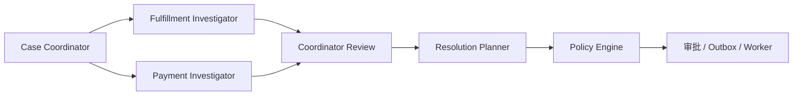

# ResolveFlow 四角色 Agent 编排

`POST /api/case-drafts` 与 `POST /api/cases/{id}/analyze` 共同构成四角色分析流程。角色负责理解、调查和提案；正式授权仍在 `policy.py`，实际退款/补发仍由 Outbox Worker 执行。

| 角色 | 代码 | 输入与输出 | 允许的证据 |
| --- | --- | --- | --- |
| Case Coordinator | `resolveflow/agents/coordinator.py` | 派发包含 Case、订单、目标、问题键、证据版本和工具范围的任务；汇总缺口与冲突 | 不执行退款或补发 |
| Fulfillment Investigator | `resolveflow/agents/fulfillment.py` | 逐步检查履约证据，给出已证实、已否定或未知的结论 | 订单、商品、发货、包裹和物流字段 |
| Payment Investigator | `resolveflow/agents/payment.py` | 逐步检查资金证据，核对支付与退款记录 | 支付状态、支付交易和退款字段 |
| Resolution Planner | `resolveflow/agents/resolution.py` | 消费调查结论，生成含未决事项的版本化整案计划 | 可读已验证证据；不能授权执行 |

`resolveflow/agents/graph.py` 将两个调查角色并行连接到 Coordinator Review 和 Planner。调查角色使用 `EvidenceSnapshotTool`，程序检查字段权限；每次任务最多执行 8 次只读查询。配置模型时，由模型在剩余允许字段中选择下一次查询，格式和字段范围均由程序校验；未配置模型时按固定字段顺序运行。任务、调查结果、整案计划和恢复进度保存在业务表，`GET /workflow` 可查询。

## 一次分析如何运行

1. 客服确认拆案草稿并创建 Case；输入证据或调用 `/collect-evidence` 取得只读接口结果。
2. Coordinator 只为尚未有有效方案的 Subcase 创建调查任务；缺件与延误交履约调查，重复扣款交资金调查。
3. 两个调查角色分别检查自己有权限读取的证据，返回任务状态、结论 `CONFIRMED` / `REFUTED` / `UNKNOWN`、证据引用、缺口与冲突。
4. Coordinator Review 判断是否需要补证或人工接管。Planner 汇总调查结果，保存版本化整案计划；Policy Engine 单独决定动作授权。
5. `/plan` 进行整案级预算、依赖和动作冲突检查；审批和 Worker 按原有可靠执行链路运行。

## 接口与恢复

证据更新会使未执行方案失效。`POST /resume` 从业务检查点重新分析相关 Subcase，产生新的 Task 与整案计划版本；没有新证据时会保持等待。`POST /takeover` 可冻结整案或指定 Subcase 的待执行动作，`POST /release` 重新开放执行。Worker 对可配置的真实动作接口先按幂等键查询状态，再决定是否重试。

调查工具读取的是已采集的持久化证据快照；HTTP 证据采集仍由 `/collect-evidence` 负责。LangGraph 节点状态保存在 SQLite 或 PostgreSQL Checkpointer，Case 的恢复阶段另存业务表。证据变化后使用新的证据版本启动一轮图分析；`interrupt()` 式的节点内暂停与继续、按交易或包裹标识继续查询仍需结合真实业务接口扩展。
