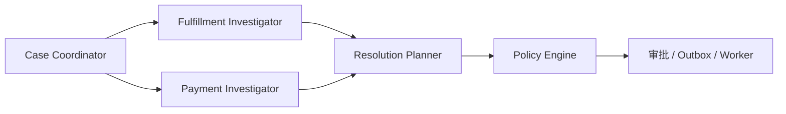

# ResolveFlow 四角色 Agent 编排

`POST /api/case-drafts` 与 `POST /api/cases/{id}/analyze` 共同构成四角色分析流程。角色负责理解、调查和提案；正式授权仍在 `policy.py`，实际退款/补发仍由 Outbox Worker 执行。

| 角色 | 代码 | 输入与输出 | 允许的证据 |
| --- | --- | --- | --- |
| Case Coordinator | `resolveflow/agents/coordinator.py` | 自然语言诉求生成待确认草稿；对已确认 Subcase 派发带 `task_id`、问题键、证据版本和步数上限的调查任务 | 不执行退款或补发 |
| Fulfillment Investigator | `resolveflow/agents/fulfillment.py` | 按问题逐步检查履约证据，返回缺失字段及证据引用 | `order_owner`、`order_total_cents`、`missing_item_confirmed`、`logistics_status` |
| Payment Investigator | `resolveflow/agents/payment.py` | 按问题逐步检查资金证据，返回缺失字段及证据引用 | `payment_status`、`refunded_cents`、`duplicate_charge_confirmed` |
| Resolution Planner | `resolveflow/agents/resolution.py` | 基于共享证据给每个问题生成候选动作 | 可读已验证证据；不能授权执行 |

`resolveflow/agents/graph.py` 将两个调查角色并行连接到方案角色。调查角色使用 `EvidenceSnapshotTool`，程序检查字段权限；每次任务最多执行 8 次只读查询。配置模型时，由模型在剩余允许字段中选择下一次查询，格式和字段范围均由程序校验；未配置模型时按固定字段顺序运行。任务派发、调查结果和方案生成写入 Case 时间线，供调试和审计。

## 一次分析如何运行

1. 客服确认拆案草稿并创建 Case；输入证据或调用 `/collect-evidence` 取得只读接口结果。
2. Coordinator 只为尚未有有效方案的 Subcase 创建调查任务；缺件与延误交履约调查，重复扣款交资金调查。
3. 两个调查角色分别检查自己有权限读取的证据，返回 `COMPLETED`、`NEEDS_INFO` 或 `SKIPPED` 及证据引用。
4. Planner 为每个待处理 Subcase 生成结构化候选动作；Policy Engine 单独决定 `ALLOW`、`REVIEW`、`DENY` 或 `NEEDS_INFO`。
5. `/plan` 进行整案级预算、依赖和动作冲突检查；审批和 Worker 按原有可靠执行链路运行。

## 后续深化

现有调查工具读取的是已经采集并持久化的证据快照。五类 HTTP 来源仍由 `/collect-evidence` 采集；按订单、交易、包裹标识的按需补查，以及多轮调查任务持久化，需在接入真实接口协议时扩展。Coordinator 的已确认 Case 调度按问题类型确定性派发，Planner 逐问题生成候选后由程序汇总整案约束。LangGraph 图尚未接入持久化 Checkpointer；跨请求审批和恢复由业务表承载。这些差异不应被描述为已完成的全自治四 Agent 系统。
